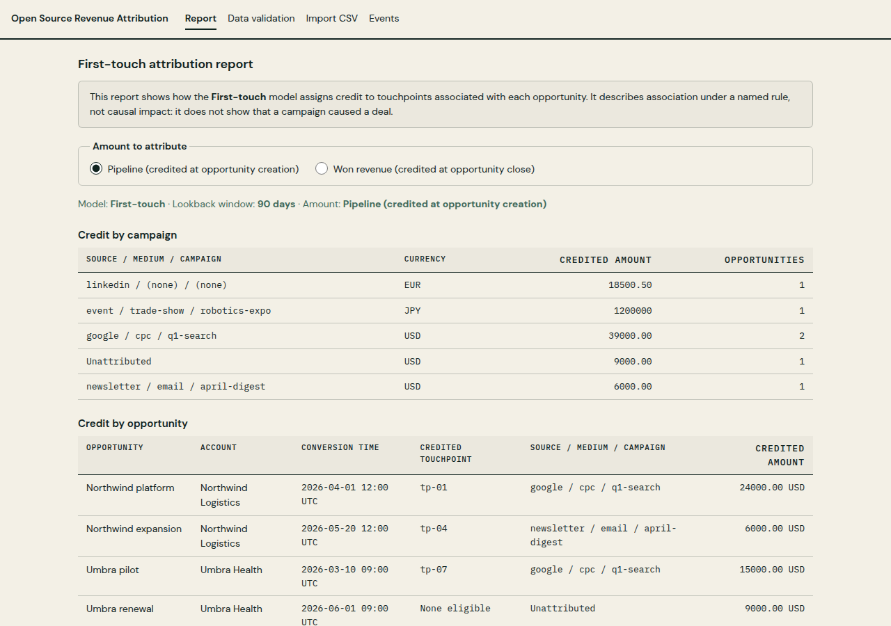
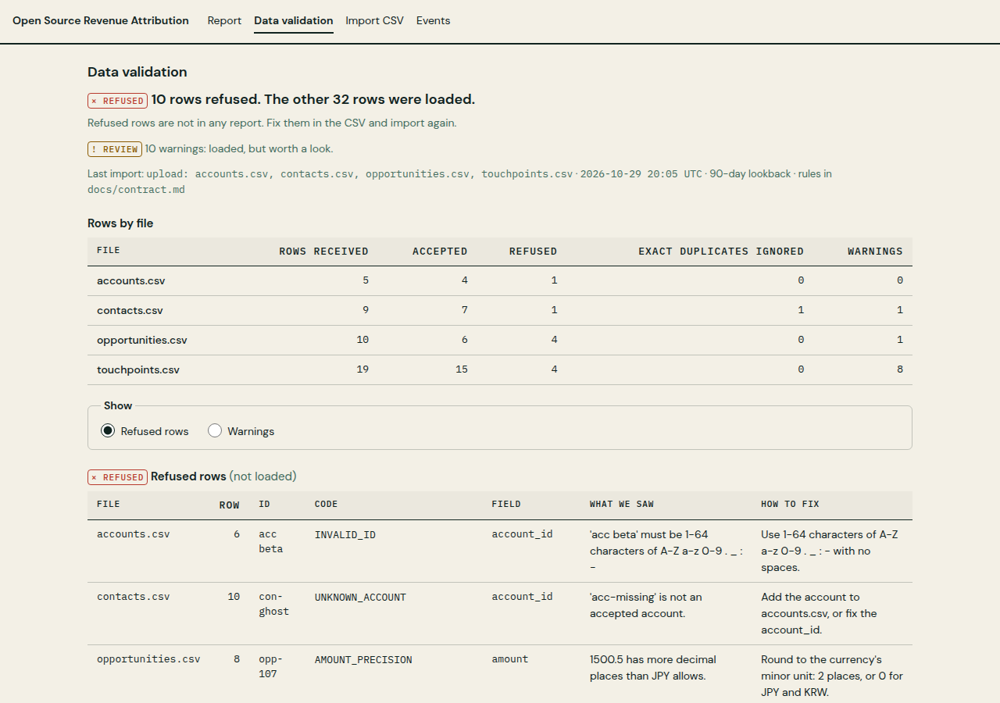

# Open Source Revenue Attribution

**See which marketing touchpoints are associated with B2B pipeline and won revenue, and inspect the math behind every number.**

[](https://github.com/ChristopherLandaverde/open-source-revenue-attribution/actions/workflows/ci.yml)
[](LICENSE)

[Quick start](#quick-start) · [What works today](#what-works-today) · [Known limits](#known-limits) · [Data contract](docs/contract.md)

A self-hostable Django app for marketers, founders and agency analysts at small B2B companies
who need a revenue report they can explain. It collects RudderStack events, imports accounts,
contacts, opportunities and touchpoints from CSV, refuses data that breaks a
[documented contract](docs/contract.md) with a reason code, and credits each opportunity under
a named model and lookback window.

Attribution here is a reporting model. It shows how a stated rule assigns credit; it does not
estimate causal impact or incrementality.

**Status:** M2 (collection and persistence) on a work branch; M1 is on `main`. One model
(first-touch). Milestones: [docs/project-management-plan.md](docs/project-management-plan.md).



## Quick start

Requires Python 3.12 and [uv](https://docs.astral.sh/uv/). These steps use SQLite; the
Postgres setup is below.

```sh
git clone https://github.com/ChristopherLandaverde/open-source-revenue-attribution.git
cd open-source-revenue-attribution
uv sync
cp .env.example .env
sed -i 's|^DATABASE_URL=.*|DATABASE_URL=sqlite:///db.sqlite3|' .env
uv run python manage.py migrate
uv run python manage.py load_sample_data
uv run python manage.py runserver
```

Open http://127.0.0.1:8000/ for the first-touch report on the synthetic demo data. Switch
between **Pipeline** and **Won revenue** to swap the tables in place.
http://127.0.0.1:8000/validation/ shows what the import refused and why: the demo data has 10
invalid rows on purpose.



The clone URL works for collaborators while the repository is private.

### Send events

```sh
uv run python manage.py create_workspace demo     # prints: Write key: <key>
curl -u '<key>:' -H 'Content-Type: application/json' \
  --data @sample_data/events/batch.json http://127.0.0.1:8000/v1/batch
```

The response lists each event's outcome. Here: 10 received, 8 accepted, 1 duplicate, 1 refused
(`TIMESTAMP_WITHOUT_TIMEZONE`). Send it again and nothing new is stored: 9 duplicates,
1 refused. http://127.0.0.1:8000/events/ shows the events and which became touchpoints.

With `DEBUG=true`, http://127.0.0.1:8000/events/demo/ loads the RudderStack JavaScript SDK and
sends identify, page and track events from your browser to the same endpoint.

<details>
<summary>Postgres with Docker (untested)</summary>

`.env.example` points at the Postgres service in `docker-compose.yml`. Skip the `sed` line and
start the database before migrating:

```sh
docker compose up -d --wait db
uv run python manage.py migrate
```

The Postgres path has not been run end to end yet; tests and the steps above use SQLite.
</details>

## What works today

| Area | What you get | Status |
|---|---|---|
| Data contract | CSV import and RudderStack event rules, 21 refusal and 7 warning codes ([docs/contract.md](docs/contract.md)) | Works |
| CSV import | `load_sample_data --path <dir>` or the **Import CSV** page: validate, load accepted rows, list refused ones. Partial by default, `--strict` / Strict checkbox refuses everything on any error. Re-import updates by ID. | Works |
| Validation report | `/validation/`: verdict, counts per file, every refused row and warning with its code and how to fix it | Works |
| Event collection | `POST /v1/batch`, `/v1/page`, `/v1/track`, `/v1/identify` with a per-workspace write key. Validated, deduplicated on `messageId`, raw payload and outcome stored. | Works |
| Events to touchpoints | Identified page views of imported contacts become touchpoints; UTMs only from `context.campaign` | Works |
| Attribution | First-touch, pipeline (at creation) and won revenue (at close), 90-day lookback, totals per currency | Works |
| Demo fixtures | Synthetic CSVs and events with hand-calculated expected results ([sample_data/](sample_data/)) | Works |
| Last-touch and linear, side by side | | Planned (M4) |
| Account and contact journeys, stage history, identify stitching | | Planned (M3) |
| Data readiness panel, attributed vs influenced | | Planned (M4) |
| Self-hosting guide, release | | Planned (M5) |

## Known limits

- **One model.** Only first-touch exists; there is nothing to compare it with yet.
- **No login.** Every page, including CSV upload, is open to anyone who can reach the server.
  Run it locally or behind your own access control.
- **Same-origin collection only.** The endpoint sends no CORS headers, so a site on another
  domain cannot post to it from the browser yet.
- **One dataset.** Write keys identify the sender; workspaces do not isolate data.
- **No sessionisation.** Every identified page view is a touchpoint, including internal pages
  without UTMs (shown as `(none)`). Anonymous page views before an identify are not linked to
  the contact. Both are open decisions ([contract assumptions 16-21](docs/contract.md#m2-assumptions-not-yet-reviewed)).
- **Browser clock.** Events from the SDK carry `originalTimestamp` only, so event time is the
  visitor's clock, uncorrected.
- **Stages are `open` and `won` only**; mixed currencies are reported side by side, never summed.
- **Postgres is untested**; SQLite is what tests and the steps above use.

## How it works

`CSV row / event → contract validator → stored record → touchpoints of the opportunity's contact → named model → credit per opportunity`

| Path | What |
|---|---|
| `contracts/` | Pure-Python contract: import and event validators, reason codes, event → touchpoint conversion. No Django imports (a test enforces it). |
| `attribution/` | Pure-Python models and types. No Django imports. |
| `collection/` | Django app: write-key workspaces, `/v1/` endpoint, stored events, events page, SDK demo page. |
| `reports/` | Django app: records, imports (command and upload page), report and validation pages. |
| `sample_data/` | Synthetic demo CSVs and events with hand-calculated expected results. |
| `static/` | Plain CSS with Focosys design tokens; vendored HTMX, RudderStack SDK and fonts (versions and hashes in `static/vendor/README.md`). |
| `docs/` | Data contract, PRD, decisions, project management plan, market research. |

## Development

```sh
uv run ruff check . && uv run ruff format --check .
uv run python manage.py check
uv run python manage.py makemigrations --check --dry-run
uv run pytest
```

Tests use in-memory SQLite (`config/settings_test.py`) and need no `.env` or Docker. They cover
the contract rules, both fixtures against their hand-calculated results, the endpoint
(auth, dedup, replay), imports from the command and the upload page, and every page. CI runs the
same commands. Repo conventions for contributors and agents: [AGENTS.md](AGENTS.md).

## License

MIT. See [LICENSE](LICENSE).
